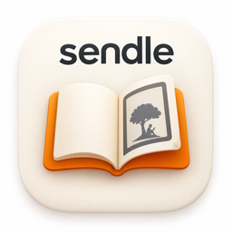

<p align="center">
  
</p>

<h1 align="center">Sendle</h1>

<p align="center">Send the books in Apple Books to your Kindle, from the menu bar.</p>

Apple Books has no way to put a book on a Kindle. Sendle reads your Books library, shows it in a small panel under the menu bar, and sends any EPUB or PDF you added yourself to your Kindle: by email through Amazon's Send to Kindle, or straight over the USB cable.

## What it does

- **Shows your Books library** in a dark panel under the menu bar: grid, list or shelf, sorted by date added, title or author, with an A–Z bar for big libraries, search and filters.
- **Sends by email** through your own Gmail, iCloud, Fastmail or other account, using an app password kept in the Keychain. Before sending, Sendle repacks each EPUB and fixes the problems that make Amazon reject or garble it.
- **Copies over USB** to a Kindle that mounts as a drive. PDFs go as they are; EPUBs are converted to AZW3 with [boko](https://github.com/zacharydenton/boko) first, with a cover thumbnail the Kindle shows.
- **Knows what's on your Kindle.** With the Kindle plugged in, the library marks which books are already on it, an On Kindle view lists everything the Kindle holds, and sending a book that's already there asks whether to skip, keep both or replace it.
- **Lets you fix a book's details** (title, author, year, ISBN, language and cover) for the copies it sends, without ever touching Books' own files.
- **Deletes books from the Kindle,** one at a time, with a few seconds to undo.
- **Explains every problem** with what happened and a button that fixes it, and shows a logs screen when you want to see what's going on underneath.

## Download

Get `Sendle-<version>.dmg` from [Releases](https://github.com/quike/sendle/releases), open it and drag Sendle into Applications. Then open Sendle from Applications and look for the book in the menu bar.

The first time, macOS stops it because it isn't notarized. Open **System Settings › Privacy & Security**, scroll down and click **Open Anyway** next to Sendle.

### Check what you downloaded

Every image comes with its SHA-256:

```bash
shasum -a 256 -c Sendle-1.0.0.dmg.sha256
```

Once the repository is public, each image also carries a build provenance attestation, which proves GitHub built it from this repository's code:

```bash
gh attestation verify Sendle-1.0.0.dmg --repo quike/sendle
```

### Why the app is not notarized

Notarizing needs a paid Apple Developer ID. Sendle is signed ad hoc instead, so no personal certificate ever leaves a developer's Mac, and the release images are built on GitHub's machines from the tagged code.

### Remove it

1. Quit Sendle from its menu (right-click the book in the menu bar).
2. Delete Sendle from Applications.
3. Delete `~/Library/Application Support/Sendle` and `~/Library/Caches/Sendle`.
4. In Keychain Access, delete the password named `io.github.quike.Sendle.smtp`.
5. Remove Sendle from **System Settings › Privacy & Security › Full Disk Access**, and from **General › Login Items** if you turned on Launch at login.

## Requirements

- **macOS 14 or later**, on Apple silicon or Intel.
- **Full Disk Access** for Sendle, so it can read the Books library (see below).
- **For email:** your Kindle's Send to Kindle address, and an email account with an app password. The account's address must be on Amazon's approved senders list.
- **For USB:** a Kindle that shows up as a drive when plugged in. EPUBs also need [boko](https://github.com/zacharydenton/boko#install) installed (`cargo install boko`). Without it, PDFs still go over USB and EPUBs go by email.

## Getting started

### Let Sendle see your Books library

macOS keeps the Books library private, and on recent versions it denies access without asking. Sendle only reads the library, never changes it, and nothing leaves your Mac unless you send a book.

1. Open Sendle. The welcome screen asks for access.
2. Click **Open Privacy Settings** and turn on **Sendle** under Full Disk Access. If it isn't listed, click **+** and choose Sendle, or drag it in from Finder.
3. Come back. Sendle checks every few seconds and notices by itself. If it doesn't, quit Sendle from its menu and open it again.

### Set up email

In the panel, click **Set up Kindle email** (or open **Settings › Kindle** and **Settings › Sender**):

| Send with | Server | App password |
|---|---|---|
| Gmail | `smtp.gmail.com`, port 465 | [Create one](https://myaccount.google.com/apppasswords) in your Google account. It needs 2-Step Verification. |
| iCloud | `smtp.mail.me.com`, port 587 | An app-specific password from [account.apple.com](https://account.apple.com). |
| Fastmail | `smtp.fastmail.com`, port 465 | Settings › Privacy & Security in Fastmail. |
| Other | your server, TLS or STARTTLS | |

Then add the sender address to Amazon's approved list: [Amazon › Preferences › Personal Document Settings](https://www.amazon.com/mycd). **Send test** saves the setup and emails your Kindle a short document, so you know it all works.

Outlook.com doesn't work: it only allows sign-in through OAuth, which Sendle doesn't support.

### Set up USB

Plug in the Kindle. Its chip appears next to Kindle email in the panel, and books copy to it straight away. For EPUBs, install boko; Sendle looks for it in `~/.cargo/bin`, `~/.local/bin`, `/opt/homebrew/bin` and `/usr/local/bin`, or wherever you point it under **Settings › USB › Choose…**.

## Using it

| Do this | To get this |
|---|---|
| Click the book in the menu bar | Open or close the panel |
| Right-click the book in the menu bar | Settings, Reveal Sendle Data, About and Quit |
| Click a destination chip | Make it where Send and quick-send go: email is blue, USB is green |
| Click a book, ⌘-click, ⇧-click | Select one, add or remove one, select a range |
| Hover a cover and click the paper plane | Quick-send that book to the active destination |
| Return | Send the selection |
| Click or drag along the A–Z bar | Jump to a letter (sort by title or author first) |
| Right-click a book › Edit Details…, or ⌘I | Change its title, author, year, ISBN, language or cover |
| Library / On Kindle switch | With a Kindle plugged in, see what's on it |
| Click a book on the Kindle | Its details, Edit in Library, or Delete… |
| ⌘Z, or Undo on the toast | Bring back a book you just deleted from the Kindle |
| Hover the Kindle chip | Eject it |

| Key | Action |
|---|---|
| ⌘1, ⌘2, ⌘3 | Grid, list, shelf |
| ⌘F | Search |
| ⌘A | Select every book that can be sent |
| Arrow keys | Move the selection |
| ⌘R | Read the Kindle again (On Kindle side) |
| ⌘, | Settings |
| Esc | Close whatever is on top, then clear the selection, then close the panel |

While books are sending, the menu bar shows `↑ 2/3`, and you can close the panel. A red dot means something needs you.

### Settings

- **General:** Launch at login; Controls (the send bar and A–Z bar attached to the panel, or floating beside it); A–Z bar (Full or Compact); Sort authors by (Surname or First name, which also decides how authors are written into the books Sendle sends); Show book format; Show logs.
- **Kindle:** your Kindle email addresses, one of them active.
- **Sender:** the account books are sent from, with Send test.
- **USB:** where boko is.

### Editing a book's details

Edits change only the copy Sendle sends; Books' library and files stay untouched. Each field shows what changed and can go back to the original with ↺. A pencil on the cover marks an edited book: send it again to update your Kindle. Renaming an author can update all their books at once. PDFs take a title and author only, which go into the file name.

## Privacy

Sendle runs on your Mac and talks to one server: your own email account's, when you send a book by email.

| Where | What |
|---|---|
| `~/Library/Application Support/Sendle/` | `settings.json` (your choices, Kindle addresses, sender address and server, but no password), `history.json` (the last 1,000 sends), `edits.json` and `edit-covers/` (your book edits), `editions.json` and `kindles/` (caches). A file Sendle can't read is moved aside as `<name>.corrupt-<time>.json`, never overwritten. |
| `~/Library/Caches/Sendle/covers/` | Cover thumbnails |
| Your login Keychain | The app password, under `io.github.quike.Sendle.smtp` |
| `$TMPDIR/Sendle-staging/` | The copy of each book being prepared, deleted after every send and at launch |
| Your Kindle | The books you send to `documents/`, their cover thumbnails in `system/thumbnails/`, and books you delete, held in `.sendle-held/` until the Undo time is over |

- Sendle reads the Books library and book files, and never writes to them. Books that are only in iCloud are never opened, so nothing downloads.
- Logs live in memory until Sendle quits. They also go to the macOS log under `io.github.quike.Sendle`, marked private. Passwords never appear in either.
- An email carries the book, its title as the subject, your sender address and "Sent by Sendle."

## Limitations

- **Newer Kindles over USB:** the Kindle Scribe and every Kindle from 2024 on don't mount as a drive (they use MTP), so they only work by email. Sendle is tested with a Kindle Paperwhite 11th gen.
- **Books bought in Apple Books** are protected by Apple's DRM and can't be sent. Sendle shows them, but never removes DRM.
- **One book per email,** and emails are limited to Amazon's 50 MB.
- **Amazon reports email problems by email.** Sendle can say a book reached Amazon, not that it reached the Kindle.
- **Kindle collections** and editing books on the Kindle itself aren't supported.

Planned and proposed features are in [Issues](https://github.com/quike/sendle/issues).

## Development

Sendle is a Swift 6 package with no third-party dependencies, split into one target per layer: the domain (`SendleDomain`), one adapter per outside system (Books, EPUB, covers, SMTP, mail, USB, persistence), the SwiftUI views (`SendleUI`) and the AppKit shell (`Sendle`). It builds with the Command Line Tools alone; Xcode isn't needed.

```bash
swift build
swift test
swift format lint --strict --recursive Package.swift Sources Tests
```

To run the real app, build it into `build/Sendle.app`:

```bash
./scripts/make-signing-identity.sh
./scripts/build-app.sh
open build/Sendle.app
```

`make-signing-identity.sh` creates a local "Sendle Local Signing" certificate, once. Without it the app is signed ad hoc, and macOS forgets its Full Disk Access and Keychain approval on every rebuild.

| Variable | What it does |
|---|---|
| `SENDLE_DATA_DIR` | Use another data folder instead of `~/Library/Application Support/Sendle`. |
| `SENDLE_LIBRARY_DB` | Read this Books-style `.sqlite` file instead of the real Books library. |
| `SENDLE_SNAPSHOT_DIR` | Render the panel's screens to PNG files in this folder and quit. Needs `SENDLE_DATA_DIR`. |
| `SENDLE_VERSION` | The version `build-app.sh` stamps into the app (default: the latest `v*` tag). |
| `APP_PATH`, `CODESIGN_IDENTITY`, `UNSIGNED` | Where `build-app.sh` puts the app, and how it signs it. |
| `SENDLE_SKIP_KEYCHAIN_TESTS` | Skip the tests that use the real Keychain (CI sets it). |
| `SENDLE_TEST_SMTP_HOST`, `_PORT`, `_USER`, `_PASS`, `_TO` | Run the live SMTP test against a real server. |
| `SENDLE_REAL_LIBRARY_CHECK=1` | Run the test that reads your real Books library (the terminal needs Full Disk Access). |
| `SENDLE_DISK_IMAGE_CHECK=1` | Run the USB tests against a disk image laid out like a Kindle. |

### Releasing

Releases come from [semantic-release](https://semantic-release.gitbook.io) through the shared [workflow-github](https://github.com/quike/workflow-github) release workflow. Every commit follows [Conventional Commits](https://www.conventionalcommits.org), and that decides the next version.

On every push to `main`, CI lints and tests. If the commits since the last release call for one, semantic-release tags it and publishes a GitHub release with notes from the commits. A macOS job then builds the disk image with that version and attaches it and its SHA-256 to the release. The releases are the changelog.

To build the same image locally:

```bash
brew install uv
SENDLE_VERSION=1.0.0 UNSIGNED=1 ./scripts/release-mac.sh
```

It writes `build/Sendle-1.0.0.dmg` and `build/Sendle-1.0.0.dmg.sha256`.

## License

[MIT](LICENSE). boko is a separate program under the GPL-3.0; Sendle runs your installed copy and doesn't include it.
